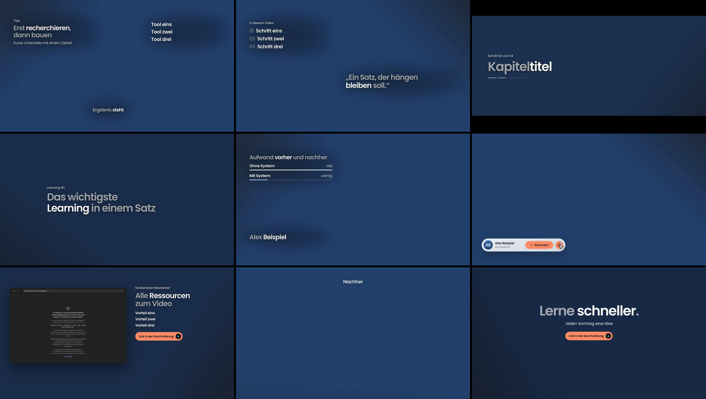

# Skill „youtube-videoschnitt“ für Claude Code

Schneidet fertig aufgenommene YouTube-Videos komplett in 4K: Pausen und Versprecher raus, Jump-Cuts mit Push-ins,
Motion Graphics im eigenen Design (cleaner Text in einer Schrift statt Kacheln, langsames Laufband hinter der Person,
Kapitel mit Kinobalken, Learnings, Listen, Zooms), CTA-Einblendung, animierter Abo-Störer, lokal komponierte Musik,
Sound-Effekte, −14 LUFS, Kapitelmarken und geschnittenes Transkript. Optional: Werbepartner-Einblendungen mit
Werbekennzeichnung und Export als DaVinci-Resolve-Timeline zum Nachjustieren.

Version 2 (November 2026).



## So funktioniert's
1. **Transkript:** Whisper schreibt jedes Wort mit Zeitstempel mit (lokal).
2. **Bild vermessen:** Claude schaut sich das Video an und bestimmt, wo Kamera, Gesicht und Bildschirm sitzen.
3. **Rohschnitt:** FFmpeg schneidet Pausen und Versprecher raus, nach dem Pegel, nicht nach Gefühl.
4. **Storyboard:** Claude plant jede Einblendung, also was, wann und wo.
5. **Positionsprüfung:** Ein Skript misst jede Einblendung im echten Layout. Nichts liegt vor dem Gesicht oder ragt über den Rand.
6. **Rendern:** HyperFrames baut jede Einblendung als kleine Webseite und rendert sie Bild für Bild in 4K, drei Spuren parallel.
7. **Musik und Ton:** MusicGen komponiert die Musik lokal, dazu Sound-Effekte und ein Mix auf −14 LUFS.
8. **Zusammenbau:** FFmpeg setzt alles zum fertigen Video zusammen, dazu Kapitelmarken und Transkript.

## Installation
1. Den Ordner `youtube-videoschnitt` nach `~/.claude/skills/` kopieren, zum Beispiel so:
   ```bash
   git clone https://github.com/timhildesheim/youtube-videoschnitt.git
   cp -R youtube-videoschnitt/youtube-videoschnitt ~/.claude/skills/
   ```
2. Claude Code starten und zum Beispiel sagen: **„Richte den Videoschnitt-Skill für mich ein.“**
   Claude führt ein kurzes Interview (Kanal, Marke, Farben, Schrift, CTA, Aufnahme-Setup, Ablage, Ton, Bilder),
   speichert dein Profil unter `~/.config/youtube-videoschnitt/` und zeigt dir eine Vorschau der Einblendungen in
   deinen Farben. Danach reicht: „Schneide mir das Video in <Ordner>.“

## Update von Version 1
Einfach den Ordner `~/.claude/skills/youtube-videoschnitt` durch den neuen ersetzen. Dein Profil liegt außerhalb und
bleibt erhalten. Danach Claude sagen: **„Aktualisiere mein Videoschnitt-Profil auf Version 2 und zeig mir die
Vorschau.“** Neu sind vor allem:
- Clean-Stil: eine Schrift, Text frei im Bild mit weichem Schatten, keine Glaskacheln und Icons mehr
- Positionsprüfung vor dem Rendern (nichts liegt mehr vor dem Gesicht oder ragt über den Rand)
- deutlich schnelleres Rendern (3 Spuren parallel)
- Werbepartner-Bausteine mit Werbekennzeichnung, Resolve-Export
- viele Fallstricke aus weiteren Produktionen (Lippensynchronität, Kamera-Sync, Whisper-Schleifen)
- eigene, frei nutzbare Sound-Effekte

## Voraussetzungen
- macOS mit Apple Silicon empfohlen (Linux geht, rendert aber langsamer), 16 GB RAM oder mehr
- Homebrew, ffmpeg 7+, Node.js 22+, Python 3 mit numpy. Der Skill prüft alles mit `scripts/check_env.sh` und richtet
  den Rest (Whisper-Modell, MusicGen, HyperFrames) beim ersten Lauf selbst ein (~6 GB Downloads)
- 25 bis 45 GB freier Platz pro 30-Minuten-Video während der Bearbeitung
- Optional für eigene Fotos und Illustrationen: ChatGPT-Desktop-App mit Abo (Codex-CLI). Ohne werden nur Screenshots genutzt.

Ein 30-Minuten-Video braucht insgesamt etwa 2 bis 3 Stunden, das meiste davon rendert der Mac allein.

## Dateien
- `youtube-videoschnitt/SKILL.md`: Ablauf für Claude
- `youtube-videoschnitt/references/`: Interview, Designsystem, Bausteine, Storyboard, Layouts, Ton, Werbepartner, Fallstricke
- `youtube-videoschnitt/scripts/`: Pipeline (Transkription, Schnitt, Rendern, Positionsprüfung, Mix, Zusammenbau,
  Resolve-Export) und Einrichtung (`setup_profil.py`, `vorschau.py`)
- `youtube-videoschnitt/profil-vorlage/profil.json`: alle Einstellungen mit Erklärungen
- `youtube-videoschnitt/assets/`: GSAP, Standardschrift Poppins, Sound-Effekte
- `werkzeuge/make_sfx.py`: erzeugt die Sound-Effekte neu (wird für den Skill selbst nicht gebraucht)

## Lizenzen
- Code und Texte des Skills: MIT, siehe `LICENSE`
- Sound-Effekte: selbst synthetisiert, CC0 (gemeinfrei), siehe `assets/sfx/CREDITS.md`
- Poppins: SIL Open Font License 1.1, siehe `assets/fonts/LIZENZ.md`
- GSAP: GreenSock Standard License (kostenlos, auch kommerziell), https://gsap.com/standard-license
- Whisper, MusicGen und HyperFrames werden beim ersten Lauf aus ihren offiziellen Quellen geladen und haben eigene
  Lizenzen. Die MusicGen-Gewichte von Meta stehen unter CC-BY-NC 4.0. Ob die damit komponierte Musik in
  monetarisierten Videos okay ist, prüfst du bitte selbst.
